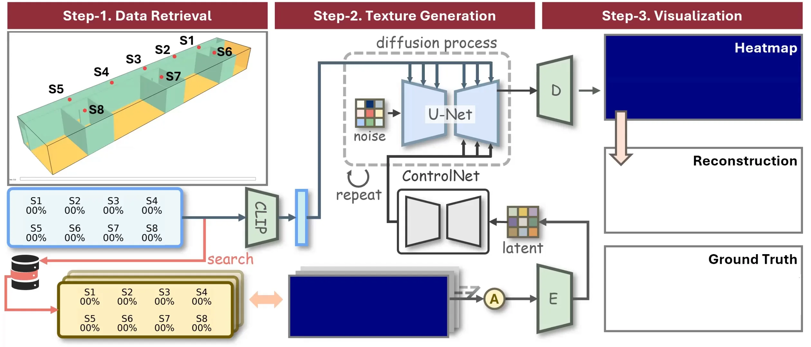

# Sensor-based Smoke Reconstruction via Retrieval-Augmented Generative Model

**Retrieval-Augmented Smoke Diffusion (RAS-Diff)** is a generative model designed
 for reconstructin dynamic smoke distribution in indoor building fire scenarios by 
 only using several sensor data readings. It leverages a Stable Diffusion model 
 trained on simulated smoke fields to generate possible smoke dispersion patterns, 
 with a Visual Case-Retrieval Augmented Generation (VC-RAG) module used for eliminating 
 hallucination issues. For more details, please refer to our  [published paper](https://www.sciencedirect.com/science/article/abs/pii/S147403462600995X).

<span id="animation"></span>


## Quick Start

### Preparation

Clone the repository:

```bash
git clone https://github.com/kugamaxx/plum-rasdiff.git
```

Install the required packages:

```bash
pip install -r requirements.txt
```

### Running the pipeline

You can run the following script to perform inference using a pretrained RAS-Diff model:

```bash
export SCENE="corridor"
export MODEL_NAME="kugamaxx/ras-diff"
export DATABASE_NAME="kugamaxx/smokepv-control"
export VALIDATION_CASE="validation/corridor_s00_c04_h1618"

python3 run_pipeline_rasdiff.py \
  --pretrained_model_name_or_path $MODEL_NAME \
  --revision "scene/$SCENE" \
  --database_name_or_path $DATABASE_NAME \
  --database_revision "scene/$SCENE" \
  --validation_case $VALIDATION_CASE \
  --top_k 3 \
  --index_dim 1024
```

**NOTE:** Since our RAS-Diff follows the 🤗[Diffusers](https://huggingface.co/docs/diffusers/index)
 library, the pretrained model and dataset will be automatically downloaded from 
 the 🤗[Hugging Face](https://huggingface.co/) when you run the script above. Or you 
 can download from [here](https://huggingface.co/KugaMaxx) and specify the local path.

## Custom Model Training

### Train your own RAS-Diff

You can run the following script to train your own RAS-Diff model, which will be
 saved to the `--output_dir`.

```bash
export SCENE="corridor"
export MODEL_NAME="stable-diffusion-v1-5/stable-diffusion-v1-5"
export DATABASE_NAME="kugamaxx/smokepv-control"
export OUTPUT_DIR=<path_to_save>

accelerate launch python3 train_rasdiff.py \
  --pretrained_model_name_or_path $MODEL_NAME \
  --dataset_name_or_path $DATABASE_NAME \
  --dataset_revision "scene/$SCENE" \
  --output_dir $OUTPUT_DIR \
  --train_batch_size 16 \
  --num_train_epochs 6 \
  --learning_rate 1e-5 \
  --validation_steps 1000 \
  --validation_ids 1500 5500 8500
```

**NOTE:** The following hyperparameters can significantly reduce GPU VRAM.
- `--mixed_precision` supports `fp16` or `bf16` mode to activate mixed precision training.
- `--gradient_checkpointing` and `--gradient_accumulation_steps` enable gradient checkpointing and gradient accumulation.
- `--use_8bit_adam` use 8-bit Adam optimizer to reduce memory usage.
- `--enable_xformers_memory_efficient_attention` activate xFormers optimized sparse attention implementation.

### Prepare training data

To train your own RAS-Diff model, you first need to prepare the training data
 in the [🤗Datasets](https://huggingface.co/docs/datasets/index) format, which
 should follow the below structure:

```markdown
data_files:
- split: train
  path: "train/*/*.parquet"
- split: validation
  path: "validation/*/*.parquet"
dataset_info:
  features:
  - name: case
    dtype: string
  - name: image
    dtype: image
  - name: conditioning_image
    dtype: image
  - name: text
    dtype: string
  - name: min_value
    dtype: float32
  - name: max_value
    dtype: float32
```

**NOTE:** The description of each field is listed below.
- `case`: The unique identifier for each smoke simulation case.
- `image`: The ground truth smoke distribution image.
- `conditioning_image`: The most similar retrieved simulation image based on the sensor readings.
- `text`: The sensor readings in a comma-separated string format.
- `min_value` and `max_value`: The minimum and maximum values of the smoke density.

## BibTeX

If you find RAS-Diff inspiring or helpful for your own research, please consider
 citing our paper:

```bibtex
@article{ding2025rasdiff,
  title = {Sensor-based Smoke Reconstruction via Retrieval-Augmented Generative Model},
  author={Ding, Saizhe and Zhang, Yuxin and Wu, Xiqiang and Xie, Weikang and Lu, Tong and Fan, Tianyu and Huang, Xinyan},
  journal={Advanced Engineering Informatics},
  pages={105303},
  year={2026},
  publisher={Elsevier}
}
```

## Acknowledgement

We would like to thank [Weikang XIE](mailto:wei-kang.xie@connect.polyu.hk) for 
 his valuable insights and support in this project.
